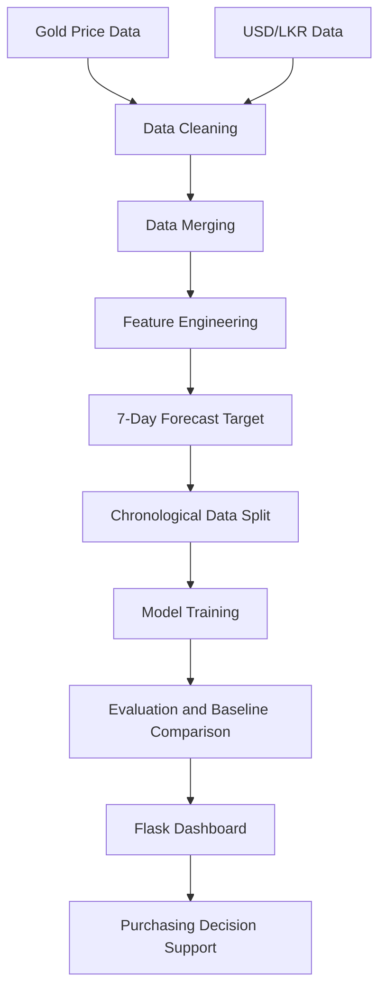

# 🪙 GoldWise

### Gold Price Forecasting & Smart Purchasing Decision Support

**Turning historical market data into clearer purchasing decisions for Sri Lankan jewellery businesses.**


## ✨ Overview

GoldWise is a machine-learning-based gold price forecasting and purchasing decision-support prototype designed to help Sri Lankan jewellery businesses make more informed raw gold purchasing decisions.

The system uses historical gold prices and USD/LKR exchange rates, creates lag, return, and rolling features, and forecasts the reference gold price in LKR per troy ounce approximately seven days ahead.

## 🚀 Key Features

- Gold price forecasting
- Data preprocessing and integration
- Feature engineering with lag, return, and rolling statistics
- Comparison of Linear Regression, Ridge, Elastic Net, XGBoost, and a naive baseline
- BUY NOW / WAIT / MONITOR decision-support signals
- Interactive Flask dashboard

## 🧩 Workflow



## 🛠️ Technologies

| Area | Technologies |
|---|---|
| Programming | Python |
| Data processing | pandas, NumPy |
| Machine learning | scikit-learn, XGBoost |
| Development | Jupyter Notebook |
| Backend | Flask |
| Frontend | HTML, CSS, JavaScript |
| Model storage | joblib |

## 📊 Model Performance

### Validation Results

| Model | RMSE (LKR) | MAE (LKR) | R² |
|---|---:|---:|---:|
| Naive Baseline | **19,427.96** | **13,159.34** | **0.9445** |
| Linear Regression | 19,636.51 | 13,524.36 | 0.9433 |
| Ridge Regression | 25,813.31 | 19,162.66 | 0.9020 |
| Elastic Net | 26,124.51 | 19,489.51 | 0.8996 |
| XGBoost | 255,896.10 | 242,647.66 | -8.6312 |

Linear Regression performed best among the four trained machine learning models, although the naive baseline performed slightly better.

### Linear Regression Test Results

- **R²:** 0.9764
- **RMSE:** LKR 35,799.76
- **MAE:** LKR 25,376.14
- **MAPE:** 2.53%

## 🖥️ Dashboard

The Flask dashboard includes Dashboard, Prediction, Model Analysis, Data Insights, Settings, and About pages.

<!-- Add screenshots here:


-->

## ⚙️ Installation

```bash
git clone https://github.com/YOUR_USERNAME/GoldWise-Gold-Price-Forecasting.git
cd GoldWise-Gold-Price-Forecasting
python -m venv .venv
python -m pip install -r requirements.txt
python app.py
```

Activate your virtual environment before installing dependencies. The dashboard also requires the trained model and metadata artifacts generated by the project notebook.

## 🗂️ Data Sources

- [Kaggle Gold Price Historical Data](https://www.kaggle.com/datasets/hamzasamiullah/gold-price-historical-data-2000-2026)
- [Central Bank of Sri Lanka Exchange Rates](https://www.cbsl.gov.lk/cbsl_custom/exrates/exrates_spot.php)
- [Central Bank of Sri Lanka Gold Reference Prices](https://www.cbsl.gov.lk/cbsl_custom/exrates/exratesgold.php)

## ⚠️ Limitations

- The dashboard is not connected to live market data.
- The forecasting horizon is approximately seven calendar days, but some matched target intervals differ.
- The naive baseline outperformed the selected ML model on validation and test sets.
- Purchasing signals are illustrative and have not been validated through an economic backtest.
- Supplier margins, taxes, duties, and jewellery-making charges are excluded.

## 🔭 Future Improvements

- Evaluate ARIMA and SARIMAX models.
- Automate data updates and model retraining.
- Add uncertainty estimates and forecast monitoring.
- Validate purchasing signals against real procurement costs.

## 👥 Project Team

**2026-DS-31 | IT3091 Machine Learning Industry Explorer Track**

A collaborative academic project covering stakeholder analysis, exploratory data analysis, preprocessing, feature engineering, model evaluation, and business decision support.

---

**GoldWise — Smarter insights for gold purchasing decisions.**
